# archfit

[](https://github.com/coupling-dev/archfit/actions/workflows/ci.yaml)
[](https://github.com/coupling-dev/archfit/tags)
[](LICENSE)

**Tests can pass while a change adds a forbidden dependency, a new cycle, or a copy of code another module owns.**

archfit checks each change against the architecture policy of your repository, `.archfit.yaml`. When a rule is in your way, you ask an owner: ask once, and the answer is remembered for the next change.



A real run in [pumba](https://github.com/alexei-led/pumba): [#414](https://github.com/alexei-led/pumba/pull/414) adds the dependency and fails the check, [#415](https://github.com/alexei-led/pumba/issues/415) is the request, and [#418](https://github.com/alexei-led/pumba/pull/418) is the owner's answer, one line in `.archfit.yaml`. The owner answers in the Archfit App. Without the App, `archfit request` prints the request for you to show an owner.

## What the check says

This record comes from a deliberate probe on archfit's own repository, at commit `cebdbc57`: one import from `internal/scope` to `internal/policy`, added to show the record and never committed.

```text
$ archfit check
internal/scope/scope.go:12: graph: analysis-scope -> architecture-policy is not an allowed dependency
  why: a new dependency between modules needs an owner
  balance: 9/10 (min 7)
  next: archfit request -m "<why you need it>"     (do not copy the code)
internal/scope/scope.go:12: layers: analysis-scope (support) -> architecture-policy (core) goes against the layer order
  why: a module may depend only on its own layer or an inner one
  next: fix the code
archfit: fail, 2 errors
policy: not protected
```

Each error says where, which rule, and what is wrong; then why, and the next step. The status line comes after the errors: `pass`, `fail`, or `unknown`, with exit code `0`, `1`, or `2`. The check compares the change with its target branch and lists only the errors the change adds. `policy: not protected` means no workflow runs the Archfit Action, so the result is a local guide.

## Start

```sh
brew install coupling-dev/tap/archfit
archfit init     # write .archfit.yaml from the code; today's errors become exceptions
archfit check    # the change: pass, fail, or unknown
```

Read the policy `init` writes, then open a pull request with it. [Getting started](docs/getting-started.md) has the other ways to install, the tools each language needs, the agent hooks, and CI.

## What archfit is and is not

archfit is a command-line check of one change against one policy file. The policy names the modules, their allowed dependencies, their layers, and your rules. archfit reads the imports and literals of Go, TypeScript, JavaScript, Python, Rust, and .NET code. The same command runs on your machine, in agent hooks, and in CI.

archfit is not a test framework, a linter for style, or a code reviewer. It does not run your tests. A missing tool makes the check `unknown` for the code it cannot read, never a pass.

|                    | archfit                                           | [ArchUnit](https://www.archunit.org/) | [import-linter](https://import-linter.readthedocs.io/) |
| ------------------ | ------------------------------------------------- | ------------------------------------- | ------------------------------------------------------ |
| Languages          | Go, TypeScript, JavaScript, Python, Rust, .NET    | Java and other JVM languages          | Python                                                 |
| Rules live in      | One policy file, `.archfit.yaml`                  | Java test code                        | A configuration file of import contracts               |
| Runs as            | A command on the change against its target branch | Tests in your test runner             | A command on the import graph                          |
| A rule in your way | `archfit request` asks an owner                   | Change the code or the test           | Change the code or the contract                        |

## Documentation

- [Getting started](docs/getting-started.md) — set up a repository and run your first check.
- [Commands](docs/commands.md) — command behavior, flags, and exit codes.
- [Configuration](docs/configuration.md) — every policy field and default.
- [Rules](docs/rules.md) — built-in rules, custom rules, and exceptions.
- [Results](docs/results.md) — the record, the statuses, JSON, and SARIF.
- [Metrics](docs/metrics.md) and [coupling](docs/coupling.md) — what the measurements mean.
- [Language support](docs/languages.md) — analyzers, tools, and coverage.
- [CI](docs/ci.md) and [agents](docs/agents.md) — automation workflows.
- [Troubleshooting](docs/troubleshooting.md) — common errors and recovery.
- [Architecture](docs/architecture.md) and [evidence](docs/evidence.md) — contributor references.
- [Development](CONTRIBUTING.md) — build and change the project.
- [Changelog](CHANGELOG.md) — release history.
